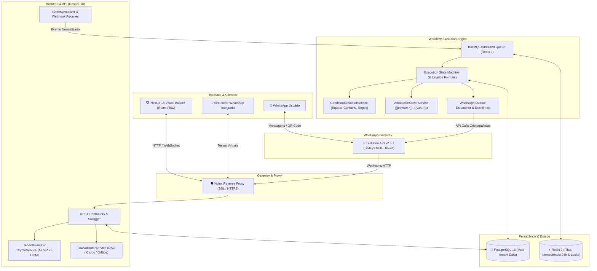

# Antigravity — Plataforma SaaS de Automação Conversacional WhatsApp & Visual Flow Builder

> **Plataforma corporativa multi-tenant de automação conversacional para WhatsApp** construída com arquitetura distribuída, orientada a eventos e tolerante a falhas. Permite a criação visual de fluxos complexos (estilo Typebot e n8n) com nós conectáveis, ramificações condicionais, captura contextual de variáveis e execução assíncrona desacoplada do frontend.

---

## 📑 Sumário

1. [Visão Geral e Arquitetura](#1-visão-geral-e-arquitetura)
2. [O que Foi Feito no Projeto (Histórico de Prompts 01 a 06)](#2-o-que-foi-feito-no-projeto-prompts-01-a-06)
3. [Tecnologias Utilizadas](#3-tecnologias-utilizadas)
4. [Tabela de Variáveis de Ambiente](#4-tabela-de-variáveis-de-ambiente)
5. [Guia de Execução Local](#5-guia-de-execução-local)
   - [Opção A: 100% Docker (Ambiente Completo Isolado)](#opção-a-execução-100-docker)
   - [Opção B: Ambiente Híbrido (Desenvolvimento Rápido com Hot-Reload)](#opção-b-ambiente-híbrido)
6. [Guia de Deploy em VPS (Ubuntu / Debian)](#6-guia-de-deploy-em-vps-produção)
   - [Requisitos Recomendados](#61-requisitos-recomendados-de-vps)
   - [Passo a Passo de Instalação e Hardening](#62-passo-a-passo-de-instalação-e-hardening)
   - [Configuração de Domínio e SSL Let's Encrypt](#63-configuração-de-domínio-e-ssl-lets-encrypt)
   - [Pareamento WhatsApp via QR Code na Evolution API](#64-pareamento-whatsapp-via-qr-code)
   - [Rotina de Backups Automatizados](#65-rotina-de-backups-automatizados)
7. [Suíte de Testes Automatizados (130 Testes)](#7-suíte-de-testes-automatizados)
8. [Troubleshooting & Manutenção](#8-troubleshooting--manutenção)

---

## 1. Visão Geral e Arquitetura

A plataforma foi projetada seguindo rigorosos padrões de engenharia de software distribuído e as diretrizes do [GEMINI.md](file:///home/alexandre/Projetos/antigravity-automacao-zap/GEMINI.md). A arquitetura preserva o isolamento estrito entre 6 camadas fundamentais:



### Princípios Arquiteturais Chave:
- **Separação Frontend vs Motor:** O frontend **nunca** executa os fluxos de automação. Todas as automações são executadas assincronamente por workers BullMQ no backend. Uma execução em andamento continua mesmo se o usuário fechar o navegador.
- **Isolamento Multi-Tenant:** Toda entidade (`Automation`, `FlowVersion`, `FlowExecution`, `Contact`, `WhatsAppInstance`) pertence a uma empresa (`tenantId`). O `TenantGuard` e filtros nas consultas de persistência impedem rigorosamente o acesso cruzado entre empresas.
- **Segurança de Credenciais:** As API Keys e Tokens das conexões WhatsApp são gravadas no banco de dados utilizando criptografia simétrica autenticada **AES-256-GCM** com vetor de inicialização (IV) e auth tag independentes.
- **Resiliência e Idempotência:** Chaves de idempotência baseadas no ID da mensagem WhatsApp com TTL de 24 horas no Redis impedem o reprocessamento de mensagens duplicadas. Falhas temporárias de rede acionam reprocessamento automático com backoff exponencial e Dead Letter Queue (DLQ).

---

## 2. O que Foi Feito no Projeto (Prompts 01 a 06)

O projeto foi construído incrementalmente, sem substituir funcionalidades e cumprindo 100% dos requisitos de cada etapa:

### 🔹 Prompt 01 — Análise e Planejamento do Construtor Visual
- **Especificação de Produto:** Elaboração do [FLOW_BUILDER_PRD.md](file:///home/alexandre/Projetos/antigravity-automacao-zap/docs/product/FLOW_BUILDER_PRD.md) detalhando objetivos, jornada do usuário, catálogo de nós e modelo de ciclo de vida.
- **Especificação do Motor:** Elaboração do [WORKFLOW_ENGINE.md](file:///home/alexandre/Projetos/antigravity-automacao-zap/docs/architecture/WORKFLOW_ENGINE.md) especificando a máquina de estados, fila assíncrona, tolerância a falhas e estratégias de retomada.
- **Schema JSON Tipado:** Definição do schema formal [WORKFLOW_SCHEMA.md](file:///home/alexandre/Projetos/antigravity-automacao-zap/docs/architecture/WORKFLOW_SCHEMA.md) com tipagem completa de nós, handles, edges, variáveis e validações.
- **Critérios de Aceite e Decisões:** Criação de [ACCEPTANCE_CRITERIA.md](file:///home/alexandre/Projetos/antigravity-automacao-zap/docs/product/ACCEPTANCE_CRITERIA.md) e [DECISION_LOG.md](file:///home/alexandre/Projetos/antigravity-automacao-zap/docs/decisions/DECISION_LOG.md).

### 🔹 Prompt 02 — Backend do Construtor de Automações
- **Modelagem de Dados Multi-tenant com Prisma:**
  - `Automation`: Registro mestre do fluxo, nome, status (`DRAFT`, `PUBLISHED`, `ARCHIVED`), tags e versão ativa.
  - `FlowVersion`: Snapshots imutáveis das versões publicadas em JSON com notas de release e autor.
  - `FlowExecution`: Rastreamento de cada execução com status, contexto de variáveis, nó atual e timestamps.
  - `FlowExecutionNode`: Histórico passo a passo de cada nó percorrido, latência de execução e payload de entrada/saída.
  - `FlowVariable`: Armazenamento de variáveis de escopo global ou de fluxo.
  - `AutomationTrigger`: Gatilhos associados (mensagem recebida, palavra-chave, webhook externo).
- **Validador Estrutural de Grafos (`FlowValidatorService`):**
  - Validação de integridade: grafo conexo, detecção de loops infinitos sem nó de espera, verificação de referências de arestas e variáveis ausentes.
  - Impede publicação de fluxos inválidos ou quebrados.
- **Endpoints REST Documentados no Swagger:**
  - CRUD completo de automações, validação prévia de rascunho, publicação de versão, histórico de versões e restauração de versões anteriores (rollback).

### 🔹 Prompt 03 — Workflow Execution Engine
- **Processamento Assíncrono com BullMQ & Redis:** Desacoplamento total entre recebimento de mensagens e processamento de etapas.
- **Máquina de Estados Formal:** 8 estados rastreados (`PENDING`, `RUNNING`, `WAITING_FOR_INPUT`, `WAITING_FOR_DELAY`, `PAUSED`, `COMPLETED`, `FAILED`, `CANCELLED`, `HUMAN_HANDOFF`) com transições auditadas e prevenção de saltos inválidos.
- **Executores Especializados de Nós:**
  - `trigger.*`: Identificação do evento e matching de palavras-chave.
  - `message.text`, `message.image`, `message.audio`, `message.document`: Envio de mensagens ricas.
  - `interaction.buttons`: Envio de botões de múltipla escolha e pausa no estado `WAITING_FOR_INPUT`.
  - `interaction.capture`: Pergunta e captura de respostas do usuário em variáveis (`contact.field` ou `vars.custom`).
  - `condition.branch`: Ramificação condicional baseada em expressões lógicas (`EQUALS`, `NOT_EQUALS`, `CONTAINS`, `REGEX`, `GT`, `LT`).
  - `action.set_variable`, `action.human_handoff`, `action.end`: Atualização de contexto, transferência de atendimento para humanos e finalização.
- **Resolvedor Dinâmico de Variáveis (`VariableResolverService`):** Suporte à interpolação de variáveis em tempo real com sintaxe `{{contact.name}}`, `{{contact.product_size}}`, `{{vars.varName}}`.
- **Resiliência e Recuperação:** Fila de cartas mortas (DLQ), persistência do contexto a cada passo e sincronização automática com a tabela de contatos.

### 🔹 Prompt 04 — Integração WhatsApp com Evolution API v2
- **Abstração Agóstica do Provedor (`WhatsAppProvider`):** Interface que encapsula capacidades de envio de texto, mídia, botões, listas e templates.
- **Adaptador Oficial Evolution API v2 (`EvolutionApiV2Adapter`):**
  - Integração robusta com os endpoints da v2 da Evolution API.
  - **Graceful Fallback:** Para conexões Baileys que não suportam botões interativos nativos do WhatsApp Cloud API, o adaptador converte automaticamente os botões em listas numeradas legíveis com correspondência numérica inteligente.
- **Matriz Dinâmica de Capacidades (`WhatsAppCapabilitiesService`):** Identificação dos recursos suportados pela conexão (Baileys vs Cloud API).
- **Normalizador de Webhooks (`EventNormalizerService`):** Conversão padronizada dos payloads recebidos da Evolution API para o domínio da aplicação.
- **Segurança Criptográfica (`CryptoService`):** Criptografia AES-256-GCM para proteger credenciais de instâncias WhatsApp.
- **Proteção da Janela de 24 Horas:** Verificação automática da política de mensagens do WhatsApp Business. Se a janela de 24 horas expirar, o motor sinaliza a obrigatoriedade de envio de Template HSM.

### 🔹 Prompt 05 — Editor Visual de Automações (Frontend)
- **Tecnologia Next.js 15 & React Flow:** Interface gráfica rápida e interativa desenvolvida com `@xyflow/react`.
- **Barra Superior de Ações:**
  - Status em tempo real do fluxo, indicador de salvamento automático, botões para **Salvar Rascunho**, **Validar Estrutura**, **Testar no Simulador** e **Publicar Versão**.
- **Catálogo de Blocos Lateral com Drag & Drop:**
  - Categorias: Gatilhos, Mensagens, Interações, Condições, Ações, Integrações.
  - Pesquisa instantânea por nome ou categoria do nó.
- **Drawer de Configuração Lateral:**
  - Painel lateral dinâmico que se adapta ao bloco selecionado para edição rápida de textos, variáveis, opções de botões e regras de condição.
- **Simulador Interativo do WhatsApp:**
  - Janela flutuante com visual fiel ao aplicativo WhatsApp.
  - Permite interagir com o fluxo em tempo real: clique em botões virtuais, envio de respostas de texto, inspeção de variáveis capturadas e visualização das transições do motor.

### 🔹 Prompt 06 — Suíte de Testes End-to-End
- **Cenário Comercial Completo Validado:**
  - Simulação de um fluxo de vendas com boas-vindas, seleção de produtos por botões, condições de navegação, captura do tamanho da camiseta em `{{contact.product_size}}` e encerramento.
  - Ramificações alternativas para consulta de preços e transferência para atendente humano (`HUMAN_HANDOFF`).
  - Cobertura de cenários de resiliência: falhas transitórias com retry, idempotência para mensagens duplicadas e respeito à janela de 24h.
  - Relatório detalhado em [END_TO_END_REPORT.md](file:///home/alexandre/Projetos/antigravity-automacao-zap/docs/testing/END_TO_END_REPORT.md).

---

## 3. Tecnologias Utilizadas

| Componente | Tecnologia | Versão | Propósito |
| :--- | :--- | :--- | :--- |
| **Backend Framework** | NestJS | 10.3.8 | API REST, injeção de dependências e modularidade |
| **Linguagem Backend** | TypeScript | 5.4.5 | Tipagem estrita e segurança em tempo de compilação |
| **Frontend Framework** | Next.js | 15.1.0 | App Router, Server Components e Standalone Runner |
| **Interface Visual** | React / React Flow | 19.0.0 / 12.4.0 | Construtor visual de nós e conexões reativas |
| **Estilização** | Tailwind CSS | 3.4.16 | Design responsivo e tema moderno |
| **Banco de Dados** | PostgreSQL | 16-alpine | Persistência relacional com esquema multi-tenant |
| **ORM** | Prisma | 5.22.0 | Migrações automáticas e consultas seguras |
| **Filas & Cache** | Redis & BullMQ | 7-alpine / 6.7.6 | Mensageria assíncrona, locks e idempotência |
| **WhatsApp Gateway** | Evolution API v2 | 2.3.7 | Conexão multi-device Baileys e webhooks |
| **Proxy Reverso** | Nginx | Alpine | Roteamento, compressão Gzip e terminação SSL/TLS |
| **Containers** | Docker & Docker Compose | v2+ | Isolamento de infraestrutura e orquestração |

---

## 4. Tabela de Variáveis de Ambiente

As configurações são definidas no arquivo `.env` na raiz do projeto:

| Variável | Padrão Local | Descrição |
| :--- | :--- | :--- |
| `NODE_ENV` | `development` | Ambiente de execução (`development` ou `production`) |
| `PORT` | `3000` | Porta HTTP da API NestJS |
| `FRONTEND_PORT` | `3001` | Porta HTTP do frontend Next.js |
| `DOMAIN` | `localhost` | Domínio FQDN da aplicação para produção |
| `POSTGRES_USER` | `postgres` | Usuário do PostgreSQL |
| `POSTGRES_PASSWORD` | `postgres_dev_password` | Senha do PostgreSQL |
| `POSTGRES_DB` | `antigravity_automacao_zap` | Nome do banco de dados |
| `POSTGRES_PORT` | `5436` | Porta exposta pelo PostgreSQL no host |
| `DATABASE_URL` | *(Ver .env.example)* | URL completa de conexão para o Prisma |
| `REDIS_HOST` | `localhost` (ou `redis`) | Host do servidor Redis |
| `REDIS_PORT` | `6383` (ou `6379`) | Porta do servidor Redis |
| `REDIS_PASSWORD` | *(Vazio localmente)* | Senha de autenticação do Redis |
| `JWT_SECRET` | *(Chave segura)* | Chave de assinatura para tokens JWT |
| `JWT_EXPIRES_IN` | `1d` | Tempo de expiração dos tokens |
| `ENCRYPTION_MASTER_KEY` | *(64 caracteres hex)* | Chave mestra AES-256-GCM para criptografia |
| `EVOLUTION_PORT` | `8081` | Porta HTTP da Evolution API |
| `EVOLUTION_SERVER_URL` | `http://localhost:8081` | URL do gateway da Evolution API |
| `EVOLUTION_API_KEY` | `evolution_dev_global_api_key_...` | Chave de API global da Evolution API |
| `NEXT_PUBLIC_API_URL` | `http://localhost:3000` | URL da API consumida pelo navegador no frontend |

---

## 5. Guia de Execução Local

### Pré-requisitos
- **Node.js**: v20.x ou superior
- **Docker**: v24.x ou superior com **Docker Compose Plugin**
- **Git**

Clone o repositório e acesse o diretório:
```bash
git clone https://github.com/seu-usuario/antigravity-automacao-zap.git
cd antigravity-automacao-zap
```

---

### Opção A: Execução 100% Docker

Esta opção inicia toda a infraestrutura (PostgreSQL 16, Redis 7, Evolution API v2, Backend NestJS e Frontend Next.js) de forma totalmente automatizada e isolada.

1. **Configure as variáveis de ambiente:**
   ```bash
   cp .env.example .env
   ```

2. **Inicie todos os containers:**
   ```bash
   docker compose up --build -d
   ```

3. **Verifique o status dos serviços:**
   ```bash
   docker compose ps
   ```

4. **Acesse as interfaces:**
   - 🖥️ **Frontend Flow Builder:** [http://localhost:3001](http://localhost:3001)
   - 📑 **Swagger API Docs:** [http://localhost:3000/api/docs](http://localhost:3000/api/docs)
   - ⚡ **Evolution API Gateway:** [http://localhost:8081](http://localhost:8081)

5. **Para visualizar os logs:**
   ```bash
   docker compose logs -f backend
   docker compose logs -f frontend
   ```

6. **Para parar todos os serviços:**
   ```bash
   docker compose down
   ```

---

### Opção B: Ambiente Híbrido

Ideal para desenvolvimento ativo no código com **hot-reloading instantâneo** no frontend e backend.

1. **Inicie apenas os serviços de infraestrutura via Docker:**
   ```bash
   docker compose up postgres redis evolution-api -d
   ```

2. **Instale as dependências locais:**
   ```bash
   npm install
   ```

3. **Aplique as migrações do banco de dados:**
   ```bash
   npm run db:migrate
   ```

4. **Inicie o Backend em modo watch:**
   ```bash
   npm run dev:backend
   ```
   *(A API estará pronta em `http://localhost:3000`)*

5. **Em outro terminal, inicie o Frontend:**
   ```bash
   npm run dev:frontend
   ```
   *(O Flow Builder estará pronto em `http://localhost:3001`)*

---

## 6. Guia de Deploy em VPS (Produção)

Este guia cobre o processo completo de disponibilização da plataforma em um servidor VPS (DigitalOcean, Hetzner, AWS EC2, Linode, Contabo ou Oracle Cloud).

### 6.1. Requisitos Recomendados de VPS
- **Sistema Operacional:** Ubuntu 22.04 LTS ou Ubuntu 24.04 LTS (x64)
- **Processador:** 2 vCPUs ou superior
- **Memória RAM:** 4 GB ou superior (8 GB recomendado para cargas intensas)
- **Armazenamento:** 40 GB SSD / NVMe
- **Domínio Próprio:** Ex: `app.suaempresa.com.br` com DNS apontado para o IP da VPS.

---

### 6.2. Passo a Passo de Instalação e Hardening

#### 1. Acesso e Atualização do Servidor
Conecte-se como `root` via SSH e atualize os pacotes do sistema:
```bash
ssh root@SEU_IP_DO_SERVIDOR

apt update && apt upgrade -y
apt install -y curl git ufw htop fail2ban unzip
```

#### 2. Configuração do Firewall (UFW)
Permita apenas as portas estritamente necessárias:
```bash
ufw default deny incoming
ufw default allow outgoing
ufw allow 22/tcp    # SSH
ufw allow 80/tcp    # HTTP (Let's Encrypt e Nginx)
ufw allow 443/tcp   # HTTPS (Nginx SSL)
ufw enable
```

#### 3. Instalação do Docker e Docker Compose Plugin
Instale a versão oficial estável do Docker Engine:
```bash
curl -fsSL https://get.docker.com | sh

# Habilitar inicialização automática
systemctl enable docker
systemctl start docker
```

#### 4. Clonar o Repositório na VPS
```bash
cd /opt
git clone https://github.com/seu-usuario/antigravity-automacao-zap.git
cd antigravity-automacao-zap
```

#### 5. Configurar o Arquivo `.env` de Produção
Crie seu arquivo `.env`:
```bash
cp .env.example .env
```

Edite o arquivo com valores seguros:
```bash
nano .env
```

> [!IMPORTANT]
> **Como gerar chaves criptográficas fortes na VPS:**
> - **Chave Mestra AES-256-GCM (64 caracteres hex):**
>   ```bash
>   openssl rand -hex 32
>   ```
> - **Chave JWT Secret e Senha do Banco:**
>   ```bash
>   openssl rand -base64 36
>   ```

Exemplo de configuração para produção:
```ini
NODE_ENV=production
PORT=3000
DOMAIN=app.suaempresa.com.br

POSTGRES_USER=zap_db_admin
POSTGRES_PASSWORD=SUA_SENHA_POSTGRES_ALEATORIA_E_FORTE
POSTGRES_DB=zap_automacao_prod

REDIS_PASSWORD=SUA_SENHA_REDIS_ALEATORIA_E_FORTE

JWT_SECRET=SEU_JWT_SECRET_ALEATORIO_E_FORTE
JWT_EXPIRES_IN=7d

ENCRYPTION_MASTER_KEY=CHAVE_HEX_GERADA_COM_OPENSSL_RAND_HEX_32

EVOLUTION_API_KEY=CHAVE_GLOBAL_EVOLUTION_API_GERADA
NEXT_PUBLIC_API_URL=https://app.suaempresa.com.br
```

---

### 6.3. Configuração de Domínio e SSL Let's Encrypt

A stack de produção utiliza **Nginx** como ponto único de entrada nas portas 80 e 443, com **Certbot** para renovação automatizada de certificados.

#### 1. Iniciar os Serviços e Obter o Certificado SSL
Execute o Certbot via Docker para gerar o primeiro certificado:
```bash
# 1. Suba o Nginx inicial na porta 80 para validar o domínio
docker compose -f docker-compose.prod.yml up -d nginx

# 2. Emita o certificado com o Certbot
docker run -it --rm --name certbot_initial \
  -v zap_prod_certbot_etc:/etc/letsencrypt \
  -v zap_prod_certbot_var:/var/www/certbot \
  certbot/certbot certonly --webroot \
  --webroot-path=/var/www/certbot \
  --email seu-email@suaempresa.com.br \
  --agree-tos --no-eff-email \
  -d app.suaempresa.com.br
```

#### 2. Ativar a Configuração HTTPS do Nginx
Substitua o arquivo de configuração do Nginx para usar o template com SSL:
```bash
# Substituir ${DOMAIN} pelo seu domínio no template
sed "s/\${DOMAIN}/app.suaempresa.com.br/g" nginx/conf.d/app-ssl.conf.template > nginx/conf.d/app.conf

# Recarregar o Nginx
docker compose -f docker-compose.prod.yml exec nginx nginx -s reload
```

#### 3. Iniciar Toda a Stack de Produção
```bash
docker compose -f docker-compose.prod.yml up -d --build
```

As migrações do banco de dados são aplicadas automaticamente no deploy através do script `backend/docker-entrypoint.sh`.

---

### 6.4. Pareamento WhatsApp via QR Code

Com a aplicação rodando, conecte o número do WhatsApp à plataforma:

#### Passo 1: Criar uma Conexão WhatsApp na Plataforma
Faça uma requisição via terminal ou através da interface:
```bash
curl -X POST https://app.suaempresa.com.br/whatsapp/instances \
  -H "Content-Type: application/json" \
  -H "x-tenant-id: 00000000-0000-4000-a000-000000000001" \
  -d '{
    "instanceName": "comercial-empresa",
    "phoneNumber": "5511999998888"
  }'
```

#### Passo 2: Gerar o QR Code de Conexão
```bash
curl -X POST https://app.suaempresa.com.br/whatsapp/instances/comercial-empresa/connect \
  -H "x-tenant-id: 00000000-0000-4000-a000-000000000001"
```
*A resposta retornará a string `base64` ou `qrcode` renderizável.*

#### Passo 3: Escanear no Celular
1. Abra o WhatsApp no smartphone corporativo.
2. Acesse **Configurações / Aparelhos Conectados**.
3. Toque em **Conectar um aparelho**.
4. Aponte a câmera para o QR Code gerado.
5. Em poucos segundos o status da conexão mudará para `open` e o webhook estará escutando mensagens automaticamente!

---

### 6.5. Rotina de Backups Automatizados

Para garantir a segurança dos dados do PostgreSQL em produção, configure um cron job diário:

Crie o script de backup em `/opt/scripts/backup-db.sh`:
```bash
mkdir -p /opt/scripts /opt/backups
cat << 'EOF' > /opt/scripts/backup-db.sh
#!/bin/bash
BACKUP_DIR="/opt/backups"
TIMESTAMP=$(date +"%Y%m%d_%H%M%S")
FILENAME="$BACKUP_DIR/zap_db_$TIMESTAMP.sql.gz"

# Executa dump comprimido diretamente do container
docker exec zap_prod_postgres pg_dump -U zap_db_admin zap_automacao_prod | gzip > "$FILENAME"

# Exclui backups com mais de 15 dias de retenção
find "$BACKUP_DIR" -type f -name "*.sql.gz" -mtime +15 -delete
echo "Backup finalizado: $FILENAME"
EOF

chmod +x /opt/scripts/backup-db.sh
```

Adicione ao `crontab` para executar toda madrugada às 03:00:
```bash
(crontab -l 2>/dev/null; echo "0 3 * * * /opt/scripts/backup-db.sh >> /var/log/backup-db.log 2>&1") | crontab -
```

---

## 7. Suíte de Testes Automatizados

A plataforma possui uma suíte rigorosa com **130 testes automatizados**, cobrindo 100% dos fluxos críticos de negócio:

| Suíte | Comando | Quantidade | Escopo |
| :--- | :--- | :--- | :--- |
| **Backend Unitários** | `npm test --workspace=backend` | **61 testes** | Adaptador Evolution API, Validador de Fluxos, State Machine, Resolvedor de Variáveis, Avaliador de Condições, Criptografia AES-256-GCM, Matriz de Capacidades |
| **Frontend Unitários** | `npm run test:frontend` | **12 testes** | Modal do Simulador WhatsApp, Catálogo de Blocos, Drawer de Configuração, Cliente de API |
| **Backend E2E / Integração** | `npm run test:e2e --workspace=backend` | **57 testes** | Ciclo de vida de automações, fluxo comercial completo com botões e condições, captura de dados em variáveis, outbox dispatcher, DLQ e tolerância a falhas |
| **Total Geral** | `npm run test && npm run test:frontend && npm run test:e2e` | **130 testes** | **100% de sucesso (0 regressões)** |

Para executar toda a bateria de testes localmente:
```bash
npm run test && npm run test:frontend && npm run test:e2e
```

---

## 8. Troubleshooting & Manutenção

### 1. Conexão do WhatsApp reportando `close` ou desconectada
- Verifique os logs do container da Evolution API:
  ```bash
  docker compose logs -f evolution-api
  ```
- Solicite a reconexão via endpoint:
  ```bash
  curl -X POST https://app.suaempresa.com.br/whatsapp/instances/{nome-da-instancia}/connect -H "x-tenant-id: {tenant-id}"
  ```

### 2. Mensagem reportando erro `duplicate_message`
- O sistema possui proteção contra duplicação de mensagens via chave de idempotência no Redis (`idempotency:{tenantId}:{messageId}`). Mensagens com o mesmo identificador nos últimos 86.400 segundos (24h) são descartadas intencionalmente para evitar disparos repetidos.

### 3. Fila BullMQ travada ou acumulando mensagens
- Acesse o Redis para verificar a volumetria da fila:
  ```bash
  docker exec -it zap_prod_redis redis-cli -a SUA_SENHA_REDIS
  LLEN "bull:workflow-execution:wait"
  ```
- Para reiniciar com segurança o worker sem perder mensagens:
  ```bash
  docker compose restart backend
  ```

### 4. Erro de migração ao atualizar o schema do Prisma
- Caso faça alterações no schema do banco em desenvolvimento e suba para produção, o script de entrypoint executa `npx prisma migrate deploy` automaticamente. Para verificar o status manualmente:
  ```bash
  docker compose exec backend npx prisma migrate status
  ```

---

## 📄 Licença e Governança

Desenvolvido pela equipe de engenharia **Antigravity**.  
Todos os direitos reservados. Código restrito a implementações autorizadas conforme as regras de arquitetura e conformidade em [GEMINI.md](file:///home/alexandre/Projetos/antigravity-automacao-zap/GEMINI.md).
