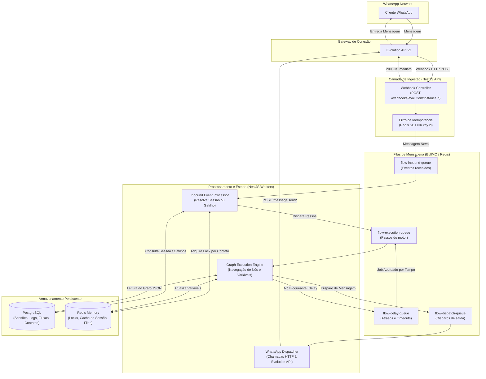
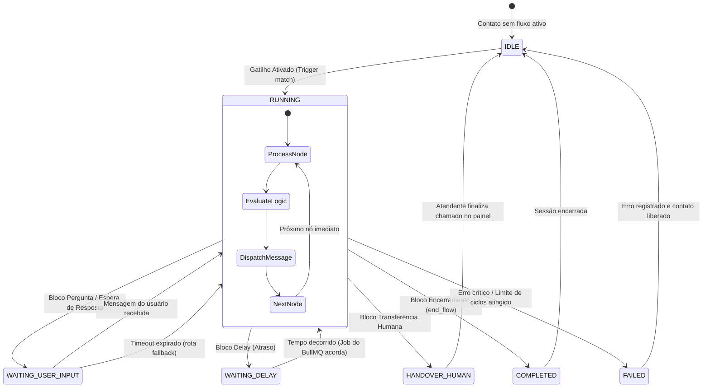

# Especificação Técnica do Motor de Execução de Fluxos (Workflow Engine)

> **Documento:** Technical Architecture & Engine Specification  
> **Status:** Aprovado para Implementação  
> **Versão:** 1.0.0  
> **Data:** 13 de Novembro de 2026  
> **Autor:** Staff Software Engineer & Software Architect  

---

## 1. Visão Geral e Princípios Arquiteturais

O **Workflow Engine** é o motor de execução assíncrono, escalável e tolerante a falhas responsável por executar fluxos conversacionais publicados no SaaS. Ele foi desenhado sob os seguintes pilares:

1. **Desacoplamento Absoluto:** O frontend (Next.js + React Flow) atua exclusivamente como construtor, validador de sintaxe e publicador de definições em JSON estruturado. Nenhuma execução ou avaliação de regra ocorre no navegador.
2. **Execução Orientada a Eventos:** O motor reage a webhooks da Evolution API através de filas distribuídas (BullMQ + Redis), liberando requisições HTTP imediatamente (< 50ms).
3. **Idempotência e Concorrência Atômica:** Travas distribuídas no Redis garantem que mensagens simultâneas do mesmo usuário nunca disparem execuções concorrentes ou sobrescrevam variáveis de sessão.
4. **Isolamento Multi-tenant Estrito:** Todos os contextos de execução, filas, tabelas e chaves de cache são particionados por `tenantId`.

---

## 2. Diagrama de Arquitetura e Fluxo de Dados



---

## 3. Desacoplamento Frontend x Backend

| Responsabilidade | Frontend (Next.js / @xyflow/react) | Backend (NestJS / BullMQ / PostgreSQL) |
| :--- | :--- | :--- |
| **Renderização do Grafo** | Canvas interativo, pan/zoom, nós customizados, badges e conexões visuais. | Não participa da renderização gráfica. |
| **Validação de Sintaxe** | Validação em tempo real: nós sem conexão, tipos de portas incompatíveis, campos obrigatórios. | Validação semântica e estrutural no momento de salvar rascunho ou publicar versão. |
| **Armazenamento** | Envia payload JSON estruturado (`nodes`, `edges`, `viewport`). | Persiste JSON imutável em `flow_versions` e metadados na tabela `flows`. |
| **Execução de Nós** | Nenhuma execução real; simulação/preview local usando mocks. | Execução real, chamadas à Evolution API, transições de estado de sessão e gravação de logs. |
| **Variáveis** | Auto-complete visual de variáveis no editor. | Avaliação, tipagem, sanitização e persistência atômica no Redis/PostgreSQL. |

---

## 4. Topologia das Filas BullMQ

Para garantir alta taxa de processamento sem bloquear threads, o motor utiliza quatro filas dedicadas:

### 4.1 `flow-inbound-queue`
- **Função:** Receber eventos brutos de webhook descarregados pelo `WebhookController`.
- **Payload do Job:**
```json
{
  "tenantId": "c39a8204-1234-4567-89ab-cdef01234567",
  "instanceId": "whatsapp-vendas-01",
  "messageId": "3EB0A1B2C3D4E5F6",
  "remoteJid": "5511999999999@s.whatsapp.net",
  "senderName": "Carlos Silva",
  "messageType": "conversation",
  "content": "Gostaria de ver o catálogo",
  "rawPayload": { "...payload Evolution..." },
  "receivedAt": "2026-11-13T19:00:00.000Z"
}
```
- **Concorrência:** 20 workers por instância de backend.

### 4.2 `flow-execution-queue`
- **Função:** Executar passos do grafo do fluxo de forma sequencial até atingir um nó de bloqueio (`wait_reply`, `delay`, `human_transfer`, `end_flow`).
- **Payload do Job:**
```json
{
  "tenantId": "c39a8204-1234-4567-89ab-cdef01234567",
  "sessionId": "a87b9c10-2345-6789-01bc-def012345678",
  "flowId": "f12c34d5-3456-7890-12cd-ef0123456789",
  "flowVersionId": "v1.2.0",
  "currentNodeId": "node_ask_name",
  "incomingInput": "Carlos Silva",
  "executionStepCount": 4
}
```

### 4.3 `flow-delay-queue`
- **Função:** Gerenciar pausas temporais (`delay`) e timeouts de espera por resposta (`wait_reply`).
- **Mecanismo:** Utiliza a funcionalidade nativa `delayed jobs` do BullMQ com delay em milissegundos.
- **Cancelamento:** Se o usuário responder antes do timeout do `wait_reply`, o job de timeout é cancelado via `job.remove()`.

### 4.4 `flow-dispatch-queue`
- **Função:** Enviar comandos HTTP para a Evolution API com controle rigoroso de taxa (rate limiting), evitando bloqueio do WhatsApp.
- **Configuração de Limite:** Máximo de 2 requisições por segundo por instância de WhatsApp conectada.

---

## 5. Máquina de Estados da Sessão (`FlowSession`)

Cada interação de um contato com o sistema gera ou atualiza uma `FlowSession`.



### Definição dos Estados de Sessão

| Estado | Significado | Comportamento ao Receber Nova Mensagem |
| :--- | :--- | :--- |
| `IDLE` | Sem fluxo ativo. | Avalia gatilhos ativos das automações do tenant. |
| `RUNNING` | Executando nós no backend. | Fila atômica retém mensagem até a máquina pausar ou mudar de estado. |
| `WAITING_USER_INPUT` | Aguardando resposta do cliente para pergunta específica. | Captura mensagem como resposta ao nó atual, valida tipo de dado e avança o fluxo. |
| `WAITING_DELAY` | Em pausa temporizada (delay ativo). | Mensagem recebida cancela o delay ou é armazenada em buffer conforme configuração do nó. |
| `HANDOVER_HUMAN` | Transferido para operador humano. | O bot **não responde** a mensagens do cliente. Notifica atendentes no painel. |
| `COMPLETED` | Concluído com sucesso. | Nova mensagem pode iniciar novo fluxo se casar com gatilhos. |
| `FAILED` | Falha crítica de execução. | Registra log de erro e libera contato. |

---

## 6. Algoritmo de Execução do Grafo

O processador de passos executa um loop sequencial com proteção anti-loop:

```typescript
async function processExecutionStep(job: Job<ExecutionStepPayload>): Promise<void> {
  const { tenantId, sessionId, currentNodeId } = job.data;
  let current = await getFlowNode(job.data.flowVersionId, currentNodeId);
  let stepCount = job.data.executionStepCount || 0;
  const MAX_CONSECUTIVE_STEPS = 25; // Proteção contra loops infinitos

  while (current) {
    stepCount++;
    if (stepCount > MAX_CONSECUTIVE_STEPS) {
      await abortSessionWithLoopError(sessionId, current.id);
      return;
    }

    // 1. Grava log de auditoria do passo
    await logStepStart(sessionId, current);

    // 2. Executa a ação do nó atual
    const result = await executeNodeLogic(current, sessionId, job.data.incomingInput);

    // 3. Verifica se o nó é bloqueante (interrompe o loop)
    if (current.type === 'question_input' || current.type === 'wait_reply') {
      await updateSessionState(sessionId, 'WAITING_USER_INPUT', current.id);
      return; // Aguarda próximo webhook do usuário
    }

    if (current.type === 'delay') {
      await scheduleDelayJob(sessionId, current.id, current.data.durationSeconds);
      await updateSessionState(sessionId, 'WAITING_DELAY', current.id);
      return; // Aguarda timer
    }

    if (current.type === 'human_transfer') {
      await updateSessionState(sessionId, 'HANDOVER_HUMAN', current.id);
      await dispatchHumanHandoverNotification(tenantId, sessionId);
      return;
    }

    if (current.type === 'end_flow') {
      await updateSessionState(sessionId, 'COMPLETED', current.id);
      return;
    }

    // 4. Determina o próximo nó com base na porta de saída (handle)
    const nextNodeId = resolveNextNodeId(job.data.flowVersionId, current.id, result.handleId);
    if (!nextNodeId) {
      // Fim do caminho sem nó explícito de encerramento
      await updateSessionState(sessionId, 'COMPLETED', current.id);
      return;
    }

    current = await getFlowNode(job.data.flowVersionId, nextNodeId);
    // Limpa entrada para nós subsequentes
    job.data.incomingInput = null;
  }
}
```

---

## 7. Controle de Concorrência e Travas com Redis

Para prevenir condições de corrida (race conditions) quando o usuário envia múltiplas mensagens simultâneas:

1. **Chave de Trava:** `lock:session:{tenantId}:{remoteJid}`
2. **Tempo de Expiração (TTL):** 10 segundos com renovação automática (*heartbeat*) se o processamento continuar ativo.
3. **Mecanismo:** `SET lock:session:{tenantId}:{remoteJid} {workerUuid} NX PX 10000`
4. **Tratamento de Contenção:** Se a trava estiver ocupada, o job de entrada é retentado via BullMQ com atraso exponencial (ex: 200ms, 400ms, 800ms) sem perda de mensagens.
5. **Liberação Segura:** Liberação via script Lua conferindo se o token gravado corresponde ao worker que está liberando:
```lua
if redis.call("get", KEYS[1]) == ARGV[1] then
    return redis.call("del", KEYS[1])
else
    return 0
end
```

---

## 8. Integração com a Evolution API v2

### 8.1 Normalização de Eventos Recebidos (`messages.upsert`)

O extrator transforma qualquer payload da Evolution API em um objeto uniforme:

```typescript
export interface InboundInteractionEvent {
  messageId: string;
  tenantId: string;
  instanceName: string;
  remoteJid: string;
  isGroup: boolean;
  senderName: string;
  interactionType: 'text' | 'button_reply' | 'list_reply' | 'media' | 'unknown';
  payloadValue: string; // Texto digitado, ID do botão clicado ou ID da linha da lista
  mediaUrl?: string;
  mediaMimeType?: string;
  timestamp: number;
}
```

### 8.2 Resolução da Resposta do Usuário
- Se o evento contiver `data.message.buttonsResponseMessage.selectedButtonId`, o tipo é `button_reply` e o valor é o `selectedButtonId`.
- Se o evento contiver `data.message.listResponseMessage.singleSelectReply.selectedRowId`, o tipo é `list_reply` e o valor é o `selectedRowId`.
- Se o evento contiver `data.message.conversation`, o tipo é `text` e o valor é o texto digitado.
- Se o evento contiver `data.message.extendedTextMessage.text`, o tipo é `text`.
- Se o evento contiver `data.message.imageMessage`, o tipo é `media`.

---

## 9. Política de Tolerância a Falhas e Retries

| Cenário de Falha | Causa Típica | Ação de Recuperação do Motor |
| :--- | :--- | :--- |
| **Instância WhatsApp Desconectada** | Celular desligado / Sessão Baileys caída. | Suspende execução, enfileira em fila de espera e notifica tenant sobre queda da conexão. |
| **Falha HTTP na Evolution API (5xx/Timeout)** | Sobrecarga temporária do servidor gateway. | Retry automático via BullMQ: até 3 tentativas com backoff exponencial (1s, 3s, 9s). |
| **Número Inválido / JID Inexistente** | Número de telefone informado com formato errado. | Falha imediata sem retry, marcação no log e encerramento da sessão com status `FAILED`. |
| **Excesso de Tentativas em Validação** | Usuário digita e-mail inválido 3 vezes consecutivas. | O nó `question_input` aciona a rota alternativa de falha (`max_retries_exceeded`) se configurada. |

---

## 10. Observabilidade e Auditoria

Todas as transições de nós geram registros estruturados na tabela `flow_step_logs`:
- `sessionId`: ID único da sessão.
- `nodeId`: ID do nó executado no grafo.
- `nodeType`: Tipo de nó (`message_text`, `condition`, etc.).
- `inputs`: Dados recebidos pelo nó.
- `outputs`: Resultado do processamento (ex: variável calculada, handle de saída escolhido).
- `executionTimeMs`: Duração do processamento do nó em milissegundos.
- `createdAt`: Timestamp com fuso horário UTC.
