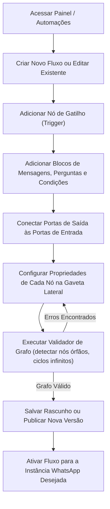
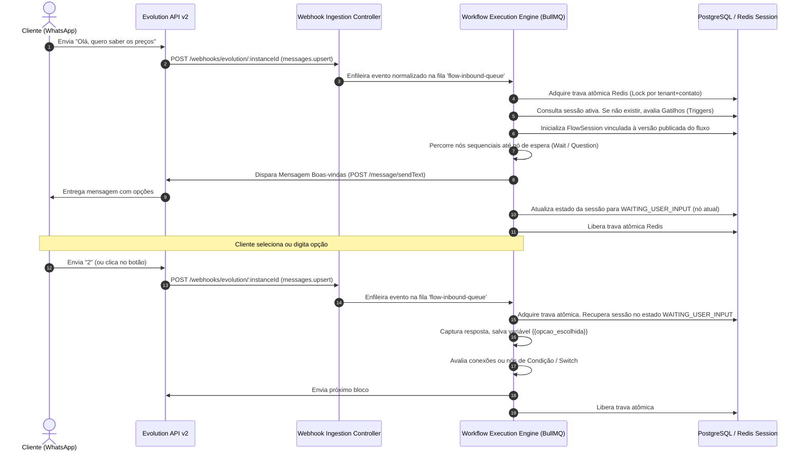

# PRD — Construtor Visual de Automações Conversacionais WhatsApp (Flow Builder)

> **Documento:** Product Requirements Document (PRD)  
> **Status:** Aprovado para Planejamento e Especificação Técnica  
> **Versão:** 1.0.0  
> **Data:** 13 de Novembro de 2026  
> **Autor:** Staff Software Engineer & Software Architect  
> **Público-alvo:** Equipes de Engenharia, Produto, QA e Operações  

---

## 1. Visão Geral e Objetivo do Produto

O **Flow Builder** é o núcleo de automação conversacional da plataforma SaaS de WhatsApp. Ele permite que empresas criem, testem, versionem e publiquem fluxos interativos de atendimento, vendas, suporte e qualificação de leads sem necessidade de código, utilizando uma interface visual baseada em nós (nodes) e conexões direcionadas (edges), no estilo **Typebot** e **n8n**.

O motor de execução correspondente opera exclusivamente no backend, desacoplado da interface gráfica, garantindo processamento distribuído, controle atômico de concorrência por contato, tolerância a falhas e integração robusta com a **Evolution API v2** (suportando conectores Baileys e WhatsApp Business Cloud API).

---

## 2. Problema de Negócio e Proposta de Valor

### 2.1 O Problema
- Automações convencionais baseadas em regras estáticas (palavra-chave $\rightarrow$ resposta fixa) geram conversas engessadas, não permitem navegação em árvore, nem ramificações condicionais.
- Plataformas corporativas de bot costumam exigir conhecimento técnico avançado, APIs proprietárias com custos proibitivos por mensagem e falta de suporte a múltiplos canais ou instâncias não oficiais (Baileys) e oficiais (Cloud API).
- Falta de controle de estado conversacional: mensagens fora de ordem causam loops infinitos, respostas duplicadas e travamentos de fluxo.

### 2.2 A Proposta de Valor
- **Interface Intuitiva No-Code:** Criação visual de árvores de decisão em tempo real com `@xyflow/react`.
- **Motor Robusto Distribuído:** Orquestração de estado via NestJS, PostgreSQL, Redis e BullMQ.
- **Isolamento Multi-tenant Rigoroso:** Cada tenant gerencia seus próprios fluxos, instâncias de WhatsApp, contatos e variáveis de forma estritamente isolada.
- **Compatibilidade WhatsApp Híbrida:** Tratamento transparente de recursos interativos com estratégia de fallback inteligente (botões e listas nativas vs. menus numéricos estruturados).

---

## 3. Personas e Cenários de Uso

### 3.1 Persona Administrador / Operador de Marketing (Builder User)
- **Perfil:** Usuário operacional ou gestor comercial que precisa criar e alterar campanhas e fluxos de atendimento sem depender de desenvolvedores.
- **Necessidades:**
  - Arrastar blocos para o canvas e conectar saídas a entradas.
  - Testar o fluxo em ambiente de simulação/prévia antes de publicar.
  - Acompanhar logs de execução e saber em qual etapa cada cliente está.

### 3.2 Persona Atendente Humano (Agent User)
- **Perfil:** Membro da equipe de suporte/vendas.
- **Necessidades:**
  - Receber conversas transferidas pelo bot com todo o histórico e variáveis coletadas.
  - Pausa imediata da automação quando o operador assume o chamado, evitando que o bot envie mensagens concorrentes.

### 3.3 Persona Cliente Final (End Customer / Lead)
- **Perfil:** Usuário comum do WhatsApp que envia mensagem para o número da empresa.
- **Necessidades:**
  - Respostas instantâneas, personalizadas e claras.
  - Opções fáceis de seleção (botões, listas ou números).
  - Possibilidade de solicitar atendimento humano a qualquer momento.

---

## 4. Jornadas do Usuário

### 4.1 Jornada de Construção e Publicação do Fluxo (Operador)

### 4.2 Jornada de Execução Conversacional (Cliente Final)

---

## 5. Escopo Detalhado da Primeira Entrega (V1)

A primeira entrega contempla exclusivamente o editor visual funcional e o mecanismo de execução no backend para os seguintes 13 tipos de blocos:

| Categoria | Tipo de Bloco | Identificador | Função no Fluxo |
| :--- | :--- | :--- | :--- |
| **Gatilho** | Gatilho de Entrada | `trigger` | Ponto de partida do fluxo. Disparado por correspondência de palavra-chave, primeira interação do contato, ou qualquer mensagem recebida. |
| **Mensagem** | Mensagem de Texto | `message_text` | Envia mensagem formatada com suporte a Spintax (`{Olá\|Oi}`) e interpolação de variáveis (`{{contact.name}}`). |
| **Mensagem** | Mídia | `message_media` | Envia imagens, vídeos, áudios (PTT) ou documentos com legenda configurável via URL pública. |
| **Mensagem** | Botões de Resposta | `buttons` | Envia botões rápidos de resposta (Quick Reply) com saídas dedicadas por botão, com fallback automático em Baileys. |
| **Mensagem** | Lista Interativa | `list_interactive` | Envia menu em lista com seções e itens selecionáveis, com fallback para menu textual estruturado. |
| **Interação** | Pergunta & Captura | `question_input` | Envia pergunta ao usuário, pausa a execução até a resposta, valida tipo do dado (texto, e-mail, telefone, número) e salva em variável. |
| **Lógica** | Condição (If/Else) | `condition` | Avalia expressões relacionais (`==`, `!=`, `contains`, `>`, `<`, `regex`) direcionando para saídas `true` ou `false`. |
| **Lógica** | Switch (Múltipla Escolha) | `switch` | Compara o valor de uma variável contra múltiplos casos estáticos, com rota padrão de fallback (`default`). |
| **Fluxo** | Espera por Resposta | `wait_reply` | Aguarda resposta livre do usuário com timeout configurável em minutos/horas e ramificação de timeout. |
| **Fluxo** | Atraso (Delay) | `delay` | Pausa a execução por tempo determinado com simulação de status no WhatsApp (`digitando...` ou `gravando áudio...`). |
| **Dados** | Definir Variável | `set_variable` | Cria, atualiza ou transforma variáveis em tempo de execução no contexto da sessão ou do contato. |
| **Finalização** | Transferência Humana | `human_transfer` | Encerra a automação do bot, marca a conversa para a fila de atendimento humano e despacha webhook/notificação. |
| **Finalização** | Encerramento | `end_flow` | Finaliza a sessão formalmente, podendo limpar variáveis temporárias e enviar mensagem de despedida. |

---

## 6. Requisitos Funcionais (RF)

### 6.1 Construtor Visual (Frontend)
- **RF-001 (Canvas Interativo):** O usuário deve poder navegar por canvas infinito com zoom, pan, grid de alinhamento e mini-mapa utilizando `@xyflow/react`.
- **RF-002 (Criação e Conexão de Nós):** O usuário deve poder adicionar nós através de menu lateral ou atalhos, e conectar portas de saída (*source handles*) a portas de entrada (*target handles*).
- **RF-003 (Validação Visual de Regras de Conexão):**
  - Nós de gatilho possuem apenas saída (não aceitam entrada).
  - Nós de encerramento e transferência possuem apenas entrada (não aceitam saída).
  - Nós de condição possuem saídas rotuladas `true` e `false`.
  - Nós de switch possuem saídas dinâmicas por caso cadastrado + saída `default`.
  - Não deve ser permitido conectar uma saída a si mesma (auto-loop direto no nó).
- **RF-004 (Edição de Propriedades):** Ao clicar em qualquer nó, um painel lateral (*drawer*) deve abrir com campos específicos para parametrização do bloco.
- **RF-005 (Validação Prévia do Fluxo):** O construtor deve possuir validador em tempo real que alerte sobre nós sem conexão, variáveis não declaradas ou fluxos sem nós de encerramento.
- **RF-006 (Versionamento e Publicação):** O usuário pode salvar rascunhos (`DRAFT`) ou publicar versões numeradas imutáveis (`v1`, `v2`, etc.).

### 6.2 Motor de Execução (Backend)
- **RF-007 (Ingestão de Webhooks):** O backend deve receber webhooks `messages.upsert` da Evolution API, responder HTTP `200 OK` em menos de 100ms e enfileirar o evento bruto.
- **RF-008 (Resolução de Contexto):** O sistema deve extrair da mensagem: tenant proprietário, instância WhatsApp, contato (`remoteJid`), tipo de mensagem e conteúdo.
- **RF-009 (Identificação de Fluxo):**
  - Se o contato já estiver em sessão ativa (`status = WAITING_USER_INPUT` ou `WAITING_DELAY`), direcionar a mensagem para a sessão corrente.
  - Se o contato não possuir sessão ativa, avaliar gatilhos ativos das automações do tenant para determinar o fluxo a iniciar.
- **RF-010 (Controle Atômico de Concorrência):** O motor deve utilizar travas distribuídas no Redis (`lock:flow:tenantId:contactId`) para garantir que mensagens simultâneas do mesmo usuário sejam processadas sequencialmente em fila estrita.
- **RF-011 (Execução Assíncrona e Não Bloqueante):** A execução sequencial de nós entre duas interações deve ocorrer em segundo plano via BullMQ, liberando recursos do servidor.
- **RF-012 (Gerenciamento de Sessão e Variáveis):** Manter estado persistido no PostgreSQL e cache no Redis com as variáveis coletadas (`{{nome}}`, `{{cpf}}`, `{{email}}`, etc.).
- **RF-013 (Atrasos e Simulação Humana):** O nó de atraso (`delay`) deve agendar um job atrasado no BullMQ e acionar a Evolution API para enviar eventos de presença (`composing` ou `recording`) no intervalo configurado.
- **RF-014 (Timeout de Espera):** O nó `wait_reply` deve criar um job agendado no BullMQ para o limite de tempo configurado; se nenhuma mensagem chegar antes do tempo limite, o fluxo avança pela porta `timeout`.
- **RF-015 (Transferência para Atendente):** Ao alcançar o bloco `human_transfer`, a sessão deve ser marcada como `HANDOVER_HUMAN`, bloqueando disparos automáticos subsequentes e disparando eventos de alerta para os atendentes.

---

## 7. Requisitos Não Funcionais (RNF)

- **RNF-001 (Performance de Resposta):** O tempo de processamento interno entre o recebimento do webhook e o envio do primeiro nó de resposta não deve exceder 500ms (descontada a latência de rede da Evolution API).
- **RNF-002 (Idempotência Estrita):** O backend deve ignorar mensagens repetidas com o mesmo `data.key.id` da Evolution API utilizando cache Redis TTL de 24 horas.
- **RNF-003 (Isolamento Multi-tenant):** Toda consulta ao banco de dados e chave no Redis deve ser escopada obrigatoriamente por `tenantId`. Nenhuma mensagem ou fluxo de um tenant pode ser acessado por outro.
- **RNF-004 (Criptografia de Credenciais):** As chaves de API da Evolution API e segredos de webhook devem ser gravadas criptografadas com AES-256-GCM.
- **RNF-005 (Proteção Anti-Loop):** O motor deve limitar o processamento consecutivo a no máximo 25 nós sem interação do usuário por mensagem recebida, abortando execuções que entrem em ciclo vicioso.
- **RNF-006 (Escalabilidade Horizontal):** O processamento de fluxos deve ser desacoplado da API REST, permitindo escalar réplicas de workers BullMQ de forma independente.
- **RNF-007 (Auditabilidade):** Todas as etapas executadas de um fluxo devem gerar logs de execução detalhados (`FlowStepLog`) com tempo de execução, nós visitados e variáveis modificadas.

---

## 8. Regras de Negócio Críticas

1. **Prioridade de Sessão Ativa:** Enquanto um contato estiver em sessão ativa (`RUNNING` ou `WAITING_USER_INPUT`), mensagens recebidas são tratadas como respostas ao fluxo atual e não disparam novos fluxos por palavras-chave, exceto comandos universais de escape (ex: `#sair`, `#cancelar`).
2. **Pausa por Atendimento Humano:** Quando uma conversa estiver no estado `HANDOVER_HUMAN`, nenhuma automação responderá a mensagens desse contato até que o operador humano encerre explicitamente o chamado.
3. **Validade de Sessões:** Sessões inativas há mais de 24 horas são expiradas automaticamente pelo sistema, liberando o contato para novas automações.
4. **Política Anti-Ban:** Não disparar mais de 1 mensagem por segundo para o mesmo contato e aplicar variação aleatória de atraso (jitter de 500ms a 1500ms) em envios automatizados.
5. **Tratamento de Mídias Grandes:** Mídias enviadas pelo bot devem obrigatoriamente residir em URLs públicas HTTPS acessíveis pela Evolution API, com timeout máximo de download de 15 segundos.

---

## 9. Métricas de Sucesso do Produto (KPIs)

- **Taxa de Conclusão de Fluxo:** % de sessões iniciadas que chegam a nós de `end_flow` ou `human_transfer` sem erros.
- **Tempo Médio de Resposta (TMR):** Latência média de processamento dos nós < 300ms.
- **Taxa de Falha em Webhooks:** < 0.1% de mensagens com erro de processamento não recuperável.
- **Retenção de Usuários no Builder:** Tempo médio para criação e publicação de um fluxo funcional inferior a 15 minutos.
